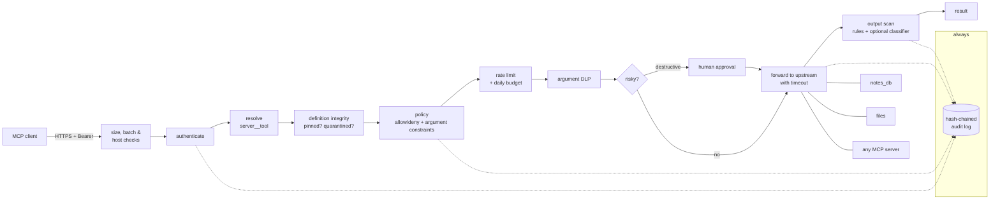

# mcp-warden

**A security gateway for the Model Context Protocol.**

An AI agent that can call tools can be talked into calling the wrong ones. A poisoned tool
description, an instruction hidden in a file the agent reads, a server that quietly changes a
tool after you approved it: each of these turns the model into the attacker's hands. mcp-warden
sits between MCP clients (Claude Desktop, Cursor, the MCP Inspector, your own agent) and the MCP
servers they use. To a client it is one MCP server; to the servers it is one MCP client. Every
`tools/list` and `tools/call` crosses a fixed security pipeline, and anything it cannot check -
because Redis is down, the audit log is unwritable, a scanner crashed - is **denied**, not waved
through.

No paid LLM API anywhere. The gateway never calls a model; the one ML component is an optional
local prompt-injection classifier.

## How a call flows



Every denial is an ordinary MCP tool result with `isError: true` and a machine-readable reason:
`WARDEN_DENIED:policy`, `WARDEN_DENIED:rate_limit`, `WARDEN_DENIED:dlp`,
`WARDEN_DENIED:injection`, `WARDEN_DENIED:quarantined`, `WARDEN_PENDING:approval`, ... -
together with the rule that decided it and a request id you can look up in the audit log.

## Features

- **Authentication** - API keys (stored as hashes) and ES256 JWTs with rotation, revocation and
  a published JWKS. The caller's credential is never forwarded to an upstream.
- **Deny-by-default policy** - per-role allow/deny rules on namespaced tools, with argument
  constraints (normalised path prefixes, lengths, ranges, regexes, enumerations). An omitted
  argument is filled from the pinned schema's default and checked like any other, so what is
  checked is what is forwarded. `tools/list` only shows what you may call. Hot reload that keeps
  the old policy if the new one is broken.
- **Tool-definition integrity** - every definition is hashed and pinned. A poisoned description
  or a later change (a *rug pull*) quarantines the tool; untrusted servers start fully
  quarantined until an admin approves.
- **Injection and exfiltration scanning** - definitions, arguments and results, including
  zero-width, bidi, base64 and non-English tricks. Secrets in arguments are refused before they
  leave (`WARDEN_DENIED:dlp`).
- **Human approval** - destructive calls wait for a person, through a CSRF-protected, strict-CSP
  web UI. Approvals are bound to the exact arguments, single-use, and cannot be self-granted.
- **Rate limits and budgets** - atomic Redis token buckets per caller and per tool, plus daily
  and destructive-call budgets.
- **Audit log** - insert-only, SHA-256 hash-chained, written *before* a call is forwarded; if it
  cannot be written the call does not happen. `warden audit verify` finds any edited, deleted,
  reordered or forged row.
- **Observability** - OpenTelemetry traces per pipeline stage, Prometheus metrics, a Grafana
  dashboard. No arguments or credentials in spans or labels.
- **Hardened by default** - request body and JSON-RPC batch limits, DNS-rebinding protection,
  bounded I/O on every dependency, a non-root read-only container.

## Quickstart

Needs Docker and Node.js. On a fresh Mac:

```bash
git clone <this-repository-url> mcp-warden && cd mcp-warden
```

```bash
cp .env.example .env
```

```bash
make up-all
```

```bash
docker compose exec gateway warden keys create --user you --roles editor
```

```bash
npx -y @modelcontextprotocol/inspector --cli http://localhost:8080/mcp --transport http --method tools/list --header "Authorization: Bearer <the key printed above>"
```

`make up-all` builds the gateway image and starts it with its upstreams, Postgres, Redis,
Jaeger, Prometheus and Grafana; it prints where each one is. Then try a call the policy refuses,
and look it up:

```bash
npx -y @modelcontextprotocol/inspector --cli http://localhost:8080/mcp --transport http --method tools/call --tool-name files__read_file --tool-arg 'path=../../etc/passwd' --header "Authorization: Bearer <key>"
```

```bash
docker compose exec gateway warden audit tail --limit 5
```

Connecting Cursor, Claude Desktop or the Inspector's web UI - including what does *not* work -
is in [docs/clients.md](docs/clients.md).

**Demo video:** not recorded yet. Until it is, the transcripts in `results/demo-*.md` show the
five attack scenarios end to end.

## Results

Every number here is generated from `results/` by `make readme-results`, which reads the files
the red-team runner, the benchmark, the soak test and the demo scenarios wrote. None of it is
typed by hand, and a test fails if it goes stale.

<!-- results:start -->
<!-- Generated by `make readme-results` from results/. Do not edit by hand. -->

**Red team** - [`results/redteam-2026-11-14.md`](results/redteam-2026-11-14.md)

| Configuration | Attacks blocked | Attack categories | Benign allowed | False positives |
| --- | --- | --- | --- | --- |
| rules only | 67/67 (100.0%) | 12 | 62/62 | 0.0% |
| rules + classifier | 67/67 (100.0%) | 12 | 61/62 | 1.6% |

**Latency added by the gateway** - [`results/bench-2026-11-14.md`](results/bench-2026-11-14.md) - 1000 calls of `notes_db__get_note` per measurement on Apple M4

Direct to the upstream, one call at a time: p50 0.93 ms. Added on top of that:

| Configuration | Concurrency | p50 added (ms) | p95 added (ms) | p99 added (ms) |
| --- | --- | --- | --- | --- |
| auth+policy | 1 | 2.11 | 2.15 | 2.26 |
| auth+policy | 10 | 17.50 | 20.38 | 62.82 |
| auth+policy | 50 | 96.64 | 138.38 | 201.74 |
| full (rules) | 1 | 3.53 | 3.65 | 4.11 |
| full (rules) | 10 | 31.56 | 36.25 | 78.98 |
| full (rules) | 50 | 163.75 | 216.58 | 228.49 |
| full (classifier) | 1 | 34.36 | 34.89 | 35.77 |
| full (classifier) | 10 | 334.24 | 439.46 | 533.45 |
| full (classifier) | 50 | 2052.81 | 2201.49 | 2238.32 |

**Soak** - [`results/soak-2026-11-14.md`](results/soak-2026-11-14.md) - 30 min at 20 calls/s

| Calls | Errors | Unexpected | p50 ms | p95 ms | p99 ms | RSS start -> end (MiB) | RSS trend | Audit chain |
| --- | --- | --- | --- | --- | --- | --- | --- | --- |
| 36000 | 0 | 0 | 22.01 | 28.06 | 29.66 | 202.47 -> 251.42 | 116.57 MiB/h whole run; 3.46 MiB/h second half | verified, 68408 rows |

**Attack scenarios** - scripted model, so every run actually attempts the attack - `results/demo-*.md`

| Scenario | Runs as required | Forbidden calls attempted | Refused | Gateway decision |
| --- | --- | --- | --- | --- |
| [benign](results/demo-benign.md) | 5/5 | 0 | 0 | allowed, as it should be |
| [indirect_injection](results/demo-indirect_injection.md) | 5/5 | 5 | 5 | `WARDEN_PENDING:approval` |
| [poisoned_server](results/demo-poisoned_server.md) | 5/5 | 5 | 5 | `WARDEN_DENIED:quarantined` |
| [exfiltration](results/demo-exfiltration.md) | 5/5 | 5 | 5 | `WARDEN_DENIED:dlp` |
| [rug_pull](results/demo-rug_pull.md) | 5/5 | 5 | 5 | `WARDEN_DENIED:quarantined` |

**Container images** - [`results/images-2026-11-14.json`](results/images-2026-11-14.json) - rules-only 103.9 MiB compressed (483MB unpacked); with-ml 3269.2 MiB compressed (9.77GB unpacked)

<!-- results:end -->

## Development

```bash
brew install uv
make setup                  # venv with every dependency group, pre-commit hooks
make up                     # postgres, redis, jaeger for a gateway run on the host
make run                    # the gateway on http://localhost:8080/mcp
make test                   # unit + integration
```

| Target | What it does |
| --- | --- |
| `make lint` | ruff, ruff format --check, mypy --strict |
| `make test` / `make test-all` | unit + integration / every layer including e2e, ml, redteam, perf |
| `make security` | bandit, and pip-audit over the locked dependencies |
| `make redteam` | every attack and benign case in `redteam/cases/`, rules-only and with the classifier |
| `make bench` / `make soak` | latency overhead / 30 minutes under load, to `results/` |
| `make demo SCENARIO=all` | the five attack scenarios; `make demo-real` drives them with Ollama |
| `make readme-results` | regenerate the table above |
| `make up-all` / `make down` | the whole stack in containers / stop it |

Optional: `uv sync --extra ml` for the local classifier, `brew install ollama` and
`ollama pull qwen2.5:7b` for the real-model demo.

## Limitations

The full list, with the reasoning, is in [docs/threat-model.md](docs/threat-model.md#known-gaps).
The ones that matter most:

- **The classifier is weak.** On this project's own measurements it adds no detection over the
  rules and costs false positives, so it ships off and can never block on its own.
- **Rules catch the attacks they were written for.** A novel phrasing that matches no rule gets
  through the scanners; policy, approvals and the audit log are the layers that assume so.
- **Approval fatigue is a human problem.** The gateway can require an approval; it cannot make
  someone read it.
- **No OAuth authorization server.** Clients need a pre-issued key or token in a header.
- **Single node.** Approval sessions are in memory.
- **Stdio upstreams run as the gateway's user.** Put an untrusted server behind HTTP in its own
  container.

## Roadmap

- Delegate token issuance to an external OAuth 2.1 server; drop the development issuer.
- Pin the audit head hash somewhere the gateway cannot write.
- Shared approval sessions for more than one gateway node.
- A CPU-only torch build for a smaller classifier image.

## Documentation

| | |
| --- | --- |
| [docs/architecture.md](docs/architecture.md) | components, protocol version, the pipeline in detail |
| [docs/threat-model.md](docs/threat-model.md) | assets, boundaries, STRIDE per component with the test behind every mitigation, known gaps |
| [docs/decisions.md](docs/decisions.md) | every non-obvious choice and every finding, phase by phase |
| [docs/clients.md](docs/clients.md) | connecting real clients, and what was verified |
| [CHANGELOG.md](CHANGELOG.md) | release notes |
| [CONTRIBUTING.md](CONTRIBUTING.md) | how to change this safely |

## License

MIT. See [LICENSE](LICENSE).
